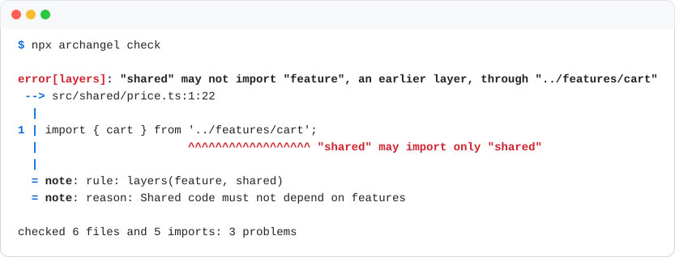

<div align="center">

# Archangel

**Make architecture verifiable.**

Architecture tests for TypeScript, checked in milliseconds.<br>
For your editor, your CI and your coding agents.

[](https://www.npmjs.com/package/@enhance-eng/archangel)
[](https://crates.io/crates/archangel)
[](https://github.com/enhance-labs-builds/archangel/actions/workflows/ci.yml)
[](#license)

<br>

<picture>
  <source media="(prefers-color-scheme: dark)" srcset="docs/assets/speed-dark.svg">
  
</picture>

<sub>Time to check the same 400 architecture rules on a 9,800-file TypeScript monorepo, on a
laptop. Without archangel, these rules need three tools.</sub>

</div>

<br>

Archangel tests the structure of your TypeScript code: which code imports which code, where files
are, and what they export. You write each architecture decision as a test. Each test is a rule: some
files, and one condition. When the code breaks a rule, archangel tells you, or your coding agent,
where, why, and what to do.

<picture>
  <source media="(prefers-color-scheme: dark)" srcset="docs/assets/check-dark.svg">
  
</picture>

## Highlights

- **Fast.** A Rust core reads each file one time. It checks 9,800 files in 1.9 seconds, 35 times
  faster than the three tools it replaces. Your editor shows the result of a change in 13
  milliseconds.
- **One tool, one config.** It holds the rules of dependency-cruiser, eslint-plugin-boundaries,
  eslint-plugin-check-file and Steiger.
- **Errors that say what to do.** Each error shows the line, the rule, your reason for the rule,
  and the permitted alternative.
- **Rules that cannot lie.** Each rule has an example of code that it must reject. If a rule cannot
  find a problem in its own example, `archangel test` fails.
- **Made for coding agents.** Watch mode, a language server, and JSON output give an agent the
  answer while it writes the code.
- **Presets and plugins.** Use the Feature-Sliced Design and Next.js presets, or write your own
  conditions in TypeScript.

## Get started

You need Node 22.18 or later.

```sh
npm install --save-dev @enhance-eng/archangel
npx archangel init --typescript
npx archangel check
```

`init` writes `archangel.config.ts`. Change it to state your architecture:

```ts
import { defineConfig } from '@enhance-eng/archangel';

export default defineConfig({
  elements: {
    feature: 'src/features/{feature}/**', // each folder in src/features is one feature
    shared: 'src/shared/**',
  },
  rules: ({ layers, isolate, entry }) => [
    layers(['feature', 'shared'], { reason: 'Shared code must not depend on features' }),
    isolate('feature', { reason: 'Features must not depend on each other' }),
    entry('feature', 'index.ts', { reason: 'Other code uses a feature only through its index.ts' }),
  ],
});
```

Then prove that each rule works. Give each rule an `examples.rejected` entry: two or three files of
code that the rule must report. `npx archangel test` checks each example in memory. A rule with a
wrong path finds no files and cannot report its example, so the test fails.
[docs/rules.md](docs/rules.md#prove-each-rule-with-examples) shows how.

## Why archangel

Part of your architecture is in the source code: which code depends on which code, where files are,
and what each part exports. A reviewer sees a diff, not the graph of imports, so this part decays a
little with each change. Coding agents write code faster than people can review it, so it now
decays faster.

Archangel makes this part of your architecture testable. Unit tests check behavior. The type
checker checks types. Archangel tests architecture.

Archangel checks structure only. Use ESLint for code style and the TypeScript compiler for types.
[docs/principles.md](docs/principles.md) gives our opinions, and the ideas that archangel comes from.

## Use it every day

| Where | How |
| --- | --- |
| **In your editor** | Problems show as you type. The VS Code extension is in [`editors/vscode`](editors/vscode), and it is not on the Marketplace yet. For other editors, read [docs/editors.md](docs/editors.md). |
| **In CI** | Add `npx archangel check --format github` and `npx archangel test --format github` to your workflow. Each problem shows on its line in the pull request. |
| **With a coding agent** | Run `npx archangel watch`. Archangel checks again after each change and prints what is new and what is fixed. |
| **To understand a file** | Run `npx archangel explain src/features/cart/index.ts`. It shows the file's element, its rules and its imports. |
| **To find a chain of imports** | Run `npx archangel why src/app.tsx react`. It shows the shortest chain from one file to the other. |
| **For an old codebase** | Run `npx archangel baseline add`. Archangel records the problems of today, and the check fails only for new problems. Read [docs/exceptions-and-baselines.md](docs/exceptions-and-baselines.md). |

## What archangel can check

- **Imports:** which code may import which code, directly or through a chain of imports. Which
  names an import brings in. How an import is written. Whether a package is in `package.json`.
- **Cycles:** files that import each other.
- **Structure:** where files must be, which files a folder must contain, and which files must not
  exist.
- **Names:** the style of file and folder names, for example `kebab-case` or `PascalCase`.
- **Exports:** what a file must export, or must not export.

## Documentation

| Page | What it tells you |
| --- | --- |
| [docs/rules.md](docs/rules.md) | Elements, selectors, each condition, and how to prove a rule |
| [docs/presets.md](docs/presets.md) | The Feature-Sliced Design and Next.js presets |
| [docs/plugins.md](docs/plugins.md) | How to write your own conditions in TypeScript |
| [docs/commands.md](docs/commands.md) | Each command and option, the output formats, and the exit codes |
| [docs/exceptions-and-baselines.md](docs/exceptions-and-baselines.md) | How to permit a problem, and how to start on an old codebase |
| [docs/editors.md](docs/editors.md) | VS Code, Neovim and other editors |
| [docs/migrating.md](docs/migrating.md) | What changes when you move from dependency-cruiser, eslint-plugin-boundaries, check-file or Steiger |
| [docs/principles.md](docs/principles.md) | What archangel believes about architecture, and why |
| [Diagnostic codes](crates/archangel_rules/docs/) | What each error means, and how to fix it |

## Install with Rust

```sh
cargo install archangel
```

To build from a clone of this repository, run `cargo install --path crates/archangel`. You need
Rust 1.93 or later.

## Contributing

Each change starts as a design, and the design's tests define when the change is done.
[CONTRIBUTING.md](CONTRIBUTING.md) tells you how to take part, and [AGENTS.md](AGENTS.md) lists the
rules of this repository.

## License

Licensed under either of [Apache License, Version 2.0](LICENSE-APACHE) or [MIT license](LICENSE-MIT),
at your option.

Unless you explicitly state otherwise, any contribution intentionally submitted for inclusion in
archangel by you, as defined in the Apache-2.0 license, shall be dual licensed as above, without
any additional terms or conditions.
