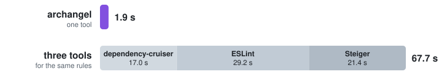

# Archangel

**Make architecture verifiable.**

### [Read the docs →](https://enhancelabs.ai/archangel/)



Architecture tests for TypeScript, checked in milliseconds. You write a table of what each part of
your code may import. Archangel tells you when the code breaks the table, and what to do about it. It checks
a large repository in about a second, so it can run in your editor as you type.

```sh
npm install --save-dev @enhance-eng/archangel
npx archangel init --typescript
npx archangel check
```

Archangel checks imports, import cycles, file and folder names, the files that folders must contain,
and exports. It has presets for Feature-Sliced Design and Next.js, and you can write your own
conditions in TypeScript.

- [Getting started](https://enhancelabs.ai/archangel/start/getting-started/)
- [Guides](https://enhancelabs.ai/archangel/guides/existing-repository/)
- [Reference](https://enhancelabs.ai/archangel/reference/conditions/)
- [Docs for coding agents](https://enhancelabs.ai/archangel/llms.txt)

The package includes a prebuilt binary for macOS, Linux and Windows. You do not need Rust.

Licensed under MIT or Apache-2.0, at your option.
